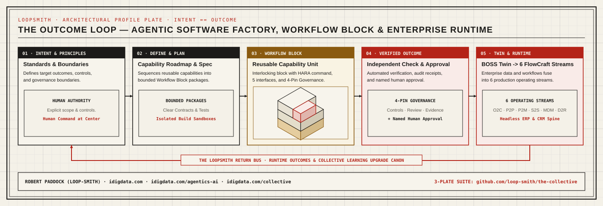

# Robert Paddock (`loop-smith`)

**CIO / CTO & Enterprise Transformation Executive (20+ years · 50+ ERP, WMS/MES, and multi-entity finance implementations).**  
Building **[The Collective (`loop-smith/the-collective`)](https://github.com/loop-smith/the-collective)**: deterministic workflow controls (`wfb.package.v1`) for the 20% of enterprise operations that ERP never captured.  
**[Inspect the P2P Worked Example & Contracts (`loop-smith/the-collective`)](https://github.com/loop-smith/the-collective)** · **[Experience](https://idigdata.com/experience/)** · **[Field Notes](https://idigdata.com/agentic-ai/)** · **[Request a Walkthrough](https://idigdata.com/collective/)**

